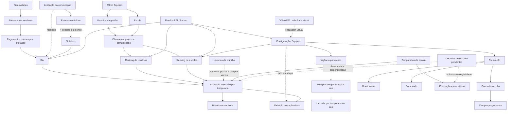

# Grafo de conhecimento

As relações com rankings e apuração representam requisitos da especificação. As setas não afirmam entrega em produção. A configuração de temporadas pela escola é descrita explicitamente com acompanhamento dos atletas; os detalhes de aplicação a usuários e escolas precisam de validação quando não especificados.

## Fontes

- [Ranking de pontuação: Atletas, Usuários e Equipes](https://app.notion.com/p/3fbfe13c365280ef892cde6bc50c9e54?pvs=204)
- [Ritmo Atletas- Atualizado](https://app.notion.com/p/331fe13c3652805a9411e3206c31208b?pvs=204)
- [🏁 Ritmo Equipe - Atualizado](https://app.notion.com/p/328fe13c3652807b88ebd5f2041eddc6?pvs=204)

## Conexões

[[04-Processos/Matriz-de-relacoes]] · [[00-Mapa/Pendencias]]

## Regras numéricas e validações

[[03-Rankings/Criterios/Atleta]] · [[03-Rankings/Criterios/Usuario]] · [[03-Rankings/Criterios/Escola]] · [[03-Rankings/Lacunas-da-planilha]] · [[90-Fontes/F21-Planilha-de-pontuacao-atualizada]]

## Avaliação da convocação

[[03-Rankings/Avaliacao-da-convocacao]] → [[03-Rankings/Criterios/Atleta]] → [[03-Rankings/Lacunas-da-avaliacao-da-convocacao]]

## Protótipo de configuração

[[03-Rankings/Configuracao-do-ranking-de-equipes]] → [[03-Rankings/Criterios/Escola]] → [[90-Fontes/F21-Planilha-de-pontuacao-atualizada]]

[[90-Fontes/F22-Video-referencia-plataforma-ranking]] -. referência visual .-> [[03-Rankings/Configuracao-do-ranking-de-equipes]]

[[90-Fontes/F23-Configuracao-de-vigencia-e-premiacao]] → [[03-Rankings/Configuracao-das-temporadas-pela-escola]] · [[03-Rankings/Premiacoes]]

[[90-Fontes/F24-Multiplas-temporadas-no-ano]] → [[03-Rankings/Configuracao-das-temporadas-pela-escola]] · [[03-Rankings/Periodicidade-e-temporadas]]

[[90-Fontes/F25-Exclusividade-de-meses-e-premiacao-opcional]] → [[03-Rankings/Configuracao-das-temporadas-pela-escola]] · [[03-Rankings/Premiacoes]]

[[90-Fontes/F26-Ajustes-de-interface-e-fluxo-da-premiacao]] → [[03-Rankings/Configuracao-do-ranking-de-equipes]] · [[03-Rankings/Premiacoes]]
