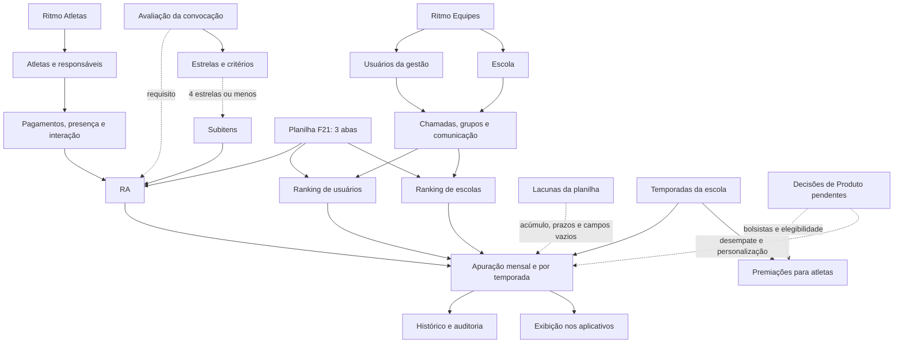

# Base de Conhecimento Ritmo — OKF

Versão 1.8 · 2026-10-22

Abra esta raiz como cofre no Obsidian e comece por [[00-Mapa/Indice]]. Os links internos usam caminhos a partir da raiz do cofre. O grafo nativo do Obsidian será formado pelos wikilinks; o mapa conceitual também está em Mermaid.

## Arquitetura

| Pasta | Conteúdo |
|---|---|
| `00-Mapa/` | Índice, grafo, cobertura e perguntas pendentes |
| `01-Atletas/` | Cadastro, matrícula, funções e procedimentos do atleta |
| `02-Equipes/` | Gestão da escola e procedimentos por módulo |
| `03-Rankings/` | Requisitos dos três rankings, temporadas e premiações |
| `04-Processos/` | Relações entre módulos e eventos |
| `05-Governanca/` | Convenções, manutenção e alterações |
| `06-Midias/` | Referências de vídeos; planilha original incluída |
| `90-Fontes/` | Registros integrais, metadados e manifesto de dependências |

## Limitações desta versão

A planilha atualizada de pontuação foi integrada e a versão anterior foi preservada como histórico. Os vídeos de referência da avaliação de treino e da plataforma de Ranking foram analisados visualmente, sem transcrição dos áudios. A configuração do Ranking de Equipes documenta a vigência por meses e as premiações nacionais ou estaduais como protótipo de interface, sem afirmar persistência ou apuração em produção. Campos vazios, divergências e regras de acúmulo permanecem pendentes. Requisitos de desenvolvimento não são apresentados como entregas confirmadas. Consulte [[00-Mapa/Pendencias]] antes de definir valores ou resolver decisões de Produto.

## Grafo de conexões

## Conexões

[[00-Mapa/Indice]]
